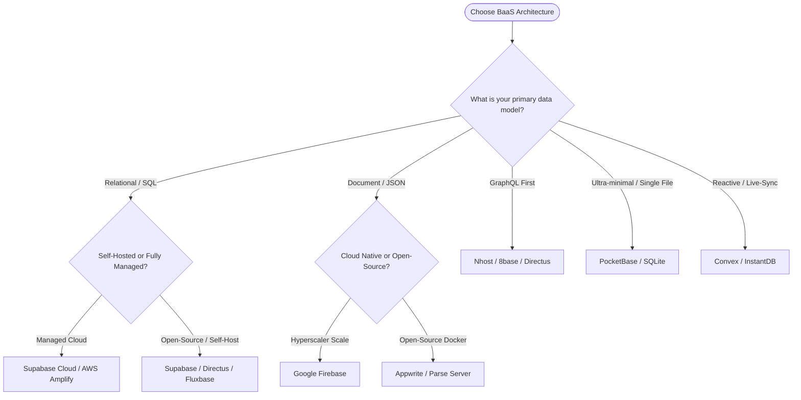

# Awesome-Backend-As-A-Service-BAAS 🚀

  

  
  
  
  
  
  

> 🌟 A curated list of Backend-as-a-Service (BaaS) SaaS products and open-source platforms for building web, mobile, AI, and edge applications. Instant REST & GraphQL APIs, authentication, real-time databases, serverless functions, storage, and self-hosted alternatives.

**Backend-as-a-Service (BaaS)** platforms accelerate software engineering by abstracting server configuration, database maintenance, real-time sync, and user authentication behind turnkey SDKs and APIs. Whether building with PostgreSQL, document databases, GraphQL, or SQLite edge workers, this directory catalogs both enterprise-grade hosted cloud vendors and community-driven, self-hostable open-source solutions.

---

## 📑 Table of Contents

- [📊 Sector Overview & Market Dynamics](#-sector-overview--market-dynamics)
- [☁️ SaaS / Hosted Platforms](#️-saas--hosted-platforms)
- [💻 Open-Source GitHub Projects](#-open-source-github-projects)
- [📐 Evaluation & Architecture Guide](#-evaluation--architecture-guide)
- [🤝 How to Contribute](#-how-to-contribute)
- [💖 Support](#-support)
- [⭐ Star History](#-star-history)
- [📜 Disclaimer & License](#-disclaimer--license)

---

## 📊 Sector Overview & Market Dynamics

The global Backend-as-a-Service (BaaS) market is valued at approximately **$4.7 billion to $6.5 billion** and is projected to expand beyond **$25 billion to $30 billion by the mid-2030s**, advancing at a robust compound annual growth rate (**CAGR of ~14% to 24%**). 📈

The industry exhibits a **hybrid two-tier structure: moderately concentrated at the enterprise cloud tier, yet highly fragmented across the modern developer and open-source ecosystem**:
- 🏢 **Concentrated Cloud Giants**: Hyperscalers like Alphabet/Google (Firebase) and Amazon Web Services (AWS Amplify) control the lion's share of enterprise and mobile workloads due to their comprehensive global infrastructure and native cloud integrations.
- 🛠️ **Fragmented Developer & Open-Source Tier**: Simultaneously, fierce innovation from independent and open-core contenders—such as Supabase, Appwrite, PocketBase, Nhost, and Convex—prevents a winner-take-all monopoly by giving developers SQL portability, predictable pricing, and sovereign self-hosting freedom away from hyperscaler vendor lock-in.

---

## ☁️ SaaS / Hosted Platforms

Comparison of leading managed BaaS platforms, sorted descending by company scale (parent/company enterprise valuation or annual revenue):

| 🏷️ Platform | 🏢 Company Scale (Valuation / Revenue) | 💳 Starting Pricing (Paid) | 🎁 Free Forever Tier Limits / Trial Limit | ⚡ Key Capabilities & Architecture |
| :--- | :--- | :--- | :--- | :--- |
| **[AWS Amplify](https://aws.amazon.com/amplify/)** | **~$2.2T+ Valuation** *(Amazon / AWS)* | **Usage-based pay-as-you-go** ($0.01/GB hosted, $0.023/GB storage; SSR compute ~$0.30/GB-hour + requests) | **12-Month Free Tier**: 5 GB file storage, 15 GB/mo bandwidth served, 1,000 build minutes/mo; Cognito includes 50,000 MAU free forever | Comprehensive AWS ecosystem integration (Cognito auth, AppSync GraphQL, DynamoDB, S3 storage, and Lambda/SSR edge hosting). |
| **[Firebase](https://firebase.google.com/)** | **~$2.1T+ Valuation** *(Alphabet / Google)* | **Pay-as-you-go (Blaze Plan)** (Starts at $0 base + metered compute/storage; typical starter apps scale from ~$25/mo) | **Spark Plan (Free Forever)**: 1 GiB total Firestore data, 50k reads/day, 20k writes/day, 20k deletes/day, 5 GB Cloud Storage (1 GB/day egress), 50k Phone/Email auths/mo | Industry benchmark for mobile and web backends. Turnkey Firestore document database, Authentication, Realtime Database, Cloud Functions, and Cloud Storage. |
| **[Kinvey](https://www.progress.com/kinvey)** | **~$2.5B+ Valuation** *(Progress Software, NASDAQ: PRGS)* | **~$2,500/year** (Enterprise starter bundle, equivalent to ~$208/month) | **30-Day Free Trial**: Full access to enterprise MBaaS sandbox, developer studio, REST API console, and custom backend data integrations | Enterprise-grade mobile BaaS tailored for HIPAA and GDPR compliant applications, legacy ERP/CRM integrations, and healthcare/ISV systems. |
| **[Supabase Cloud](https://supabase.com/)** | **~$500M+ Valuation** *(Series B)* | **$25/month** *(Pro plan per organization)* | **Free Plan**: 500 MB PostgreSQL database, 1 GB file storage, 2 GB bandwidth/mo, 50,000 MAUs, 500k Edge Function invocations/mo (Pauses after 1 week inactivity) | The premier open-source Firebase alternative. Dedicated PostgreSQL with Row Level Security (RLS), auto-generated REST/GraphQL APIs, Auth, Storage, and Realtime CDC. |
| **[Convex Cloud](https://www.convex.dev/)** | **~$150M+ Valuation** *(Series A)* | **$25/developer/month** *(Professional tier)* | **Free / Starter Plan**: 0.5 GB database storage, 1 GB/mo database I/O, 1 Million function calls/mo, up to 6 team seats, 40 deployments | TypeScript-native reactive database backend with deterministic functions, automatic caching, ACID transactions, and instant live synchronization. |
| **[Appwrite Cloud](https://appwrite.io/)** | **~$100M+ Valuation** *(Series A)* | **$15/seat/month** *(Pro tier)* | **Free Tier**: 75,000 monthly active users (MAU), 2 GB file storage, 10 GB bandwidth/mo, 750k function executions/mo (Never pauses) | Complete BaaS suite featuring MariaDB document database, auth, file storage, serverless cloud functions, localization, and multi-protocol real-time websockets. |
| **[Backendless](https://backendless.com/)** | **~$5M–$10M Annual Revenue** | **$15/month** *(Scale Plan starting tier)* | **Springboard Free Plan**: 1 GB storage, 15,000 total DB records across max 20 tables, 50 API req/min (1,000 req/day), 100k push notifications/mo | Visual full-stack BaaS with UI Builder, Codeless business logic, real-time relational database, geofencing, and automated push notifications. |
| **[Nhost Cloud](https://nhost.io/)** | **~$10M–$20M Valuation** *(Seed / Early Stage)* | **$25/month** *(Pro tier)* | **Starter Plan (Free Forever)**: 1 active project, 1 GB PostgreSQL database, 1 GB file storage, 10 serverless functions, daily automated backups | Instant GraphQL backend powered by Hasura over PostgreSQL with integrated authentication, Hasura storage, and NodeJS serverless execution. |
| **[8base](https://www.8base.com/)** | **~$5M–$15M Valuation** *(Seed Stage)* | **$25/month** *(Developer Tier)* | **Free Tier**: 1,000 database records, 1,000 GraphQL API calls/mo, 1,000 real-time subscriptions/mo, 500 MB storage, up to 5 client application users | GraphQL-native BaaS combining auto-generated relational database APIs, role-based security, serverless event functions, and Low-Code app builder. |
| **[Kuzzle Cloud](https://kuzzle.io/)** | **~$3M–$6M Annual Revenue** | **Custom Enterprise Quote / PoC** | **Open-Source Free Forever (Self-Hosted)** or **Custom 30-Day Managed PoC Trial** upon request with enterprise demo sandbox | High-performance multi-protocol BaaS (HTTP, WebSocket, MQTT) with real-time pub/sub, geofencing, and Elasticsearch backend optimized for IoT and logistics. |

---

## 💻 Open-Source GitHub Projects

Self-hosted Backend-as-a-Service, headless data platforms, and reactive backends sorted descending by GitHub Stars_Count:

- **[Supabase](https://github.com/supabase/supabase)**   
  ⚡ **The leading open-source Firebase alternative** *(Apache-2.0)*. Bundles a full PostgreSQL relational database with row-level security (RLS), PostgREST instant APIs, GoTrue authentication, storage, vector embeddings (`pgvector`), and WebSockets realtime change data capture (CDC). Deployable anywhere via Docker or Kubernetes.

- **[Strapi](https://github.com/strapi/strapi)**   
  🚀 **Leading open-source headless CMS and API engine** *(Community Edition)*. 100% JavaScript/TypeScript framework providing instant auto-generated REST and GraphQL APIs, customizable admin panels, role-based access control (RBAC), and media library management over PostgreSQL, SQLite, or MySQL.

- **[NocoDB](https://github.com/nocodb/nocodb)**   
  🔥 **Open-source Airtable and BaaS hybrid platform** *(AGPL-3.0)*. Transforms any existing relational database (PostgreSQL, MySQL, SQLite, SQL Server) into an interactive smart spreadsheet with auto-generated REST/GraphQL endpoints, webhook automations, role permissions, and views.

- **[PocketBase](https://github.com/pocketbase/pocketbase)**   
  📦 **Zero-dependency backend in 1 Go binary** *(MIT)*. Embedded SQLite database with real-time subscriptions, built-in authentication, S3-compatible file storage, and an elegant embedded administrative dashboard. Runs on a $5/month VPS with under 20 MB of idle memory.

- **[Appwrite](https://github.com/appwrite/appwrite)**   
  🛡️ **Full-spectrum open-source Firebase alternative** *(BSD-3-Clause)*. Document database backed by MariaDB with comprehensive authentication (OAuth, magic URL, phone, anonymous), cloud functions in 30+ runtimes, file storage, push notifications, and real-time event streaming.

- **[Payload CMS](https://github.com/payloadcms/payload)**   
  🛠️ **Code-first, full-stack Next.js and Node BaaS framework** *(MIT)*. Delivers native TypeScript database models over PostgreSQL or MongoDB, instant REST/GraphQL APIs, field-level access control, and a fully customizable React admin UI.

- **[Directus](https://github.com/directus/directus)**   
  🐰 **Open-source data engine and API wrapper** *(BUSL-1.1)*. Layers dynamic REST and GraphQL APIs instantly on top of any existing SQL database without proprietary migrations or schema lock-in, accompanied by an intuitive no-code data management studio.

- **[SurrealDB](https://github.com/surrealdb/surrealdb)**   
  🌌 **Multi-model database and all-in-one BaaS platform** *(BSL-1.1)*. Unifies relational, document, graph, geospatial, and vector search with real-time live queries, granular table/row permissions, and direct frontend connections without intermediate backend servers.

- **[Parse Server](https://github.com/parse-community/parse-server)**   
  📱 **The foundational open-source mBaaS framework** *(Apache-2.0)*. Battle-tested Node.js backend providing push notifications, social authentication, file storage, Cloud Code, and LiveQuery real-time database subscriptions over MongoDB or PostgreSQL.

- **[Amplication](https://github.com/amplication/amplication)**   
  ⚙️ **Developer platform for auto-generating enterprise Node.js backends** *(Apache-2.0)*. Generates production-ready NestJS and Prisma codebases with auto-configured PostgreSQL databases, GraphQL APIs, REST APIs, Passport auth, and Kafka event streaming.

- **[Convex Backend](https://github.com/get-convex/convex-backend)**   
  ⚡ **Open-source reactive database engine** *(FSL-1.1-Apache-2.0)*. The official open-source core behind Convex Cloud written in Rust. Executes reactive TypeScript functions directly on the database with automatic real-time consistency.

- **[Instant](https://github.com/instantdb/instant)**   
  🔮 **Modern client-side reactive database and BaaS** *(Apache-2.0)*. Built specifically for real-time collaborative and AI-driven applications with optimistic client updates, offline synchronization, and relational graph queries right from the frontend.

- **[Nhost](https://github.com/nhost/nhost)**   
  🎯 **GraphQL-first open-source Firebase alternative** *(MIT)*. Assembles PostgreSQL, Hasura GraphQL engine, GoTrue authentication, and MinIO storage into a unified Docker Compose stack for instant self-hosted deployments.

- **[Kuzzle](https://github.com/kuzzleio/kuzzle)**   
  📡 **Multi-protocol backend for IoT and real-time apps** *(Apache-2.0)*. High-throughput event engine supporting HTTP, WebSocket, MQTT, and STOMP with real-time geofencing, advanced search, and fine-grained access rights.

- **[Fluxbase](https://github.com/nimbleflux/fluxbase)**   
  🤖 **Lightweight single-binary Supabase alternative** *(AGPL-3.0)*. Written in Go with PostgreSQL as the sole dependency. Features REST/GraphQL APIs, OAuth2/OIDC/SAML auth, pgvector search, AI/RAG knowledge bases, and an MCP (Model Context Protocol) server.

- **[Fluxend](https://github.com/fluxend/fluxend)**   
  🏎️ **Self-hosted Go BaaS for PostgreSQL** *(GPL-3.0)*. Auto-generates PostgREST endpoints, organization multi-tenancy, JWT auth, S3 file storage, CSV/Excel imports, and automated audit trails.

- **[EdgeBase](https://github.com/edge-base/edgebase)**   
  🌐 **Edge-native BaaS on Cloudflare Workers and Durable Objects** *(MIT)*. Allocates an isolated Durable Object with embedded SQLite per tenant, achieving near-zero millisecond cold starts with global multi-region edge deployment.

---

## 📐 Evaluation & Architecture Guide

Choosing the right BaaS depends on your application architecture, operational appetite, and data model:

### 🔍 Key Selection Factors

1. 🗄️ **SQL vs. NoSQL / Document**:
   - If your application domain requires relational integrity, complex joins, and analytical reporting, select **Supabase**, **Nhost**, or **Directus** (PostgreSQL/SQL).
   - If your schema is rapidly evolving, unstructured, or mobile-first, select **Firebase** or **Appwrite**.
2. 🛠️ **Operational Overhead**:
   - **Zero DevOps**: Cloud platforms like **Firebase**, **Supabase Cloud**, or **Convex** eliminate server maintenance.
   - **Self-Hosted Simplicity**: **PocketBase** requires only a single executable binary, while **Appwrite** and **Supabase** run cleanly through Docker Compose.
3. 💸 **Bandwidth & Egress Costs**:
   - On managed platforms, file storage bandwidth and real-time WebSocket connection hours can rapidly outpace basic tier subscription costs. Ensure you inspect egress pricing for high-volume consumer media apps.

---

## 🤝 How to Contribute

Contributions to this ecosystem catalog are warmly welcomed:

1. 🍴 Fork this repository.
2. 📝 Update `README.md` with your new BaaS product or open-source repository. Ensure entries follow the existing structured tabular or bulleted format.
3. 🏷️ For open-source entries, ensure you include the official social Stars_Badge formatted as:  
   ``
4. 💰 For SaaS entries, include specific pricing tiers, free tier quotas, and corporate scale metrics.
5. 🚀 Submit a Pull Request with a clear description of the project.

---

## 💖 Support

A huge thank you to everyone exploring, using, and contributing to this ecosystem! 🙏

If you found this curated list helpful in your projects, architecture research, or stack evaluations, please consider showing your support:
- ⭐ **Star this repository** to help others discover it.
- 🍴 **Fork and contribute** updates, newly discovered projects, or corrections.
- 📢 **Share it** with friends, colleagues, or on tech communities.
- ☕ **Buy me a coffee / Sponsor**: If you'd like to support ongoing curation and open-source tooling, consider sponsoring via the [GitHub Sponsor Dashboard](https://github.com/sponsors/ishandutta2007).

---

## ⭐ Star History

---

## 📜 Disclaimer & License

- ℹ️ This list is community-curated for informational purposes. Product names, logos, and brands are property of their respective owners.
- 🔐 Open-source platforms must be evaluated for your specific enterprise security, GDPR, and data governance compliance standards.
- ⚖️ Distributed under the [Creative Commons Zero v1.0 Universal](LICENSE) license.
